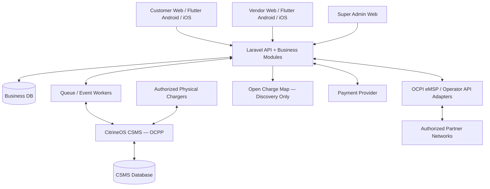

# Target Architecture — Commercial EV Charging Platform

## Logical topology


## Boundaries
- **Laravel**: canonical customer/vendor identities, tenants, station search catalog, capability/provenance metadata, reservations, invoice and transaction business rules, finance reconciliation, loyalty/fleet, admin APIs.
- **CSMS**: OCPP transport and charger operation; maintain independently versioned deployment and storage. Sync business events asynchronously through authenticated interfaces; do not use shared mutable tables.
- **OCPI and operator adapters**: distinct CPO and eMSP roles; partner-specific credentials, location/tariff/session/CDR translation, dedupe, timeouts and retries. Verify supported roles and endpoints in selected OSS release.
- **Payments**: hosted/tokenized PSP flows, webhook authentication and idempotent processing. Real payment/merchant activation is external.
- **Frontend**: role-specific customer/vendor interfaces sharing design and API SDKs. Confirm Flutter Web suitability for vendor/admin management screens; adopt web-native UI if better. Keep Android/iOS build pipelines.
- **Internationalization**: region configuration table(s), multi-currency decimal amounts and explicit minor units, local taxes/rules, data privacy settings, legal and contract constraints; never assume a single global PSP or tax treatment.

## Data-integrity invariants
- Server is authoritative for availability and booking slots. Concurrency must prevent double reservations for controlled inventory.
- A charger command belongs to an authorized principal, vendor, station and connector; every command carries idempotency/correlation ID, observable status and immutable audit events.
- Sessions, tariff quotes, meter readings, CDR, invoice, payment, refunds and settlement link through stable IDs and reconcile. Ledger entries must not silently change after posting.
- Third-party discovered stations are never displayed as live controllable without authenticated partner capability evidence.

## Source-code workspace suggestion
```
/apps/customer/            # Customer web/mobile application(s)
/apps/vendor/              # Vendor web/mobile application(s)
/apps/admin/               # Admin web portal
/services/business-api/    # Laravel app
/services/csms/            # Pinned CitrineOS deployment configuration
/services/integrations/    # OCPI & operator adapters where distinct service is justified
/packages/                 # Shared design, client SDK/contracts
/infra/                    # Docker, IaC, CI/CD and environment config
/docs/                     # Architecture decisions, test evidence, progress, runbooks
/reference/                # Original business plan
```
The agent may refine repository layout following actual upstream package structure; log material deviations in `docs/DECISIONS.md`.
