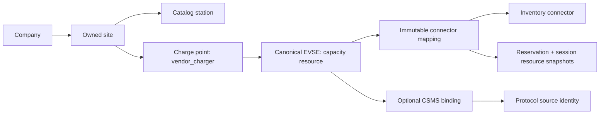

# Canonical direct-managed charging topology

Status: **SIMULATED_TESTED / INTEGRATED_TESTED** for the workflows/evidence below, not physical or production acceptance. Existing finance math, immutable journals, station tariffs and quoted invoices are preserved. New owner instructions: MASTER_AGENT2_CONTINUATION.md.

An EVSE supplies one simultaneous charging capacity. Alternate physical connectors on that EVSE share a reservation and active-session resource; different EVSEs can reserve/start in parallel. This prevents the incorrect assumption that every plug on one EVSE can charge a different vehicle simultaneously. Application simulators and CSMS simulators are explicit distinct modes. Existing legacy stations/bookings remain intact; no unknown physical capacity is inferred.

## Schema and activation

Migration `2026_10_29_000001` adds `charging_evses`, immutable-identity connector maps, nullable reservation/session resource snapshots and a nullable link mapping. Existing records remain nullable/legacy. The old single-station active slot becomes separate legacy and canonical EVSE partial unique indexes. A partial unique active-session index prevents a still-active or uncertain prior slot from starting another session on the same EVSE. Short station/company/EVSE locks serialize admission and cross-legacy activation; the database indexes remain authoritative. Same-key retries recheck inside the lock and return the original row; changed mapping/body conflicts.

Binding station uniqueness is replaced by explicit per-charge-point binding identity, while identifier and charger uniqueness remain. Legacy paths reject ambiguous bindings instead of selecting the first. Mapping requires the station’s linked site, matching company ownership/country, operational approval/license, simulator inventory, compatible source protocol and unique source target. OCPP1.6 uses source EVSE0 and an explicit connector; OCPP2.0.1 uses a positive source EVSE and explicit connector. Alternative connectors on one physical source EVSE cannot create a second canonical capacity. No identity mutation/deletion API is exposed. Mapping activation refuses current/future legacy bookings, active legacy sessions and uncorrelated command history; cancel/finish/reconcile those records first. Existing bookings/quotes are never silently retargeted.

Apply migrations before workers. Down migration refuses historical mappings or multiple-source data before DDL: parallel history cannot safely collapse to the old station key. A data-preserving rollback needs an explicit migration/review; do not delete history to force rollback. Original financial schema and economic values are unchanged.

## APIs and surfaces

- Public cookie `GET /api/stations/{station}/connectors`, and native-token alias `/api/v1/stations/{station}/connectors`: paginated choices with canonical IDs, EVSE/connector numbers, type/power and truthful `SIMULATED`, unknown live availability. Private source identifier/binding/maintenance/KYC details are withheld. Station discovery filters match type and power on the same mapped connector; legacy station summary fields remain for compatibility, while mapped UI asks for actual connector capabilities.
- Existing reservation POST accepts `connector_mapping_id`; it is required once mappings exist. The server derives EVSE ownership/capacity; clients cannot provide their own resource key. Reservation lists expose the stored mapping/EVSE and the correct transport mode.
- Under existing authenticated `/api/vendor-ops` and `/api/v1/vendor-ops`: company/charger `GET evses`, `GET source-options`, `POST evses`, and `POST evses/{evse}/connectors/{connector}/mapping`. Owner/consented inventory permissions and current approval/license are enforced server-side. The existing Admin binding endpoint accepts an explicit `vendor_charger_id` for additional charge points.
- Vendor/Admin web inventory and native vendor/staff inventory open EVSE mapping, page sources/EVSEs/connectors, create EVSEs and confirm immutable assignments. Application mappings have no source; CSMS fields are explicit. Uncertain writes require authoritative refresh and are never automatically replayed.
- Customer web/native selects a paginated connector choice before the existing booking/date/confirmation flow. The selected mapping is sent to the backend. Arabic/RTL/themes/error/loading/late-response handling are retained. Public callbacks cannot repopulate actions after identity change.

## Transport and source correlation

CSMS starts/stops resolve the stored session binding and exact mapping, never an arbitrary station’s first binding. Remote start uses mapped OCPP1.6 `connectorId` or OCPP2.0.1 `evseId`; source events must additionally attest the selected connector. The signed inbox requires mapped source fields and includes them in canonical replay fingerprints. Legacy event hashes are unchanged. Stops and final-meter reconciliation remain available after company suspension/maintenance.

CitrineOS2.1 normalized EVSE/transaction pointers are database IDs and do not reliably retain OCPP2.0.1 EVSE numbers. The observer checks the authenticated persisted Started TransactionEvent payload, scoped by station/transaction/remote-start identity, before forwarding any canonical source event. OCPP1.6 resolves the persisted connector foreign key to its protocol connector number. The private GraphQL projection adds OCPPMessages; raw credentials/messages are not returned to clients or copied into business rows. Missing/mismatched proof fails closed for reconciliation. Existing durable meter cursors/replay/unsent expiry are preserved.

## Executed acceptance

- Laravel full suite: 172 tests /6,499 assertions; focused topology 9 cases.
- Disposable PostgreSQL topology: 9 tests /135 assertions. Four independent-process booking races: same EVSE with different plugs →one201/one409; different EVSEs →two201; identical retry →201/200 and one audit/row; changed payload same key →one201/one409. 4 tests /52 assertions.
- Existing financial/managed/vendor PostgreSQL workflows97 /5,866 and all process suites19 /235 pass, preserving financial integrity while including the four new races.
- Native analysis clean,54 unit/widget passes and3 explicit default live-only skips. Eight new topology cases include scoped payloads, Arabic digits, paging/retry, readonly staff, uncertainty and disposal. Separate actual-Laravel native topology client1 pass.
- Real browser: vendor creates EVSEs/maps; customer parallel EVSE bookings, shared-plug conflict, cancellation/reuse, Arabic phone width and logout cleanup pass. Existing e2e/vendor/roaming/commercial/managed/contract/localization/session suites pass.
- Both OCPP1.6 and2.0.1 actual local CitrineOS flows use source connector7 /EVSE5, verify the received remote-start target, restart the actual observer, reconcile2,500Wh to one329-minor-unit simulated invoice and simulated payment/refund. No hardware or real money occurred. This is not proof of concurrent physical multi-EVSE hardware behavior.

Hosted Android/iOS builds and current-source CI are tracked separately after push; existing older green runs do not verify these newer sources until they execute. Source API/node fixtures and synthetic data are explicitly local, not a legal KYC, merchant or charger acceptance bypass.

## Remaining software

Unused-booking expiry/no-show/check-in/calendar policies, per-connector source status/freshness, production authenticated provisioning/token lifecycle and uncertain-command recovery, OCPI identity/action authority, maps and complete applications remain unfinished. OCPI normalized discovery is still separate and not actionable: this direct-managed milestone does not grant partner control. Full vendor creation/KYC/staff/mobile parity and non-financial/financial Admin/security/release scope remain required. No platform-complete or production-ready claim is made.
